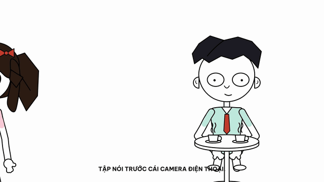
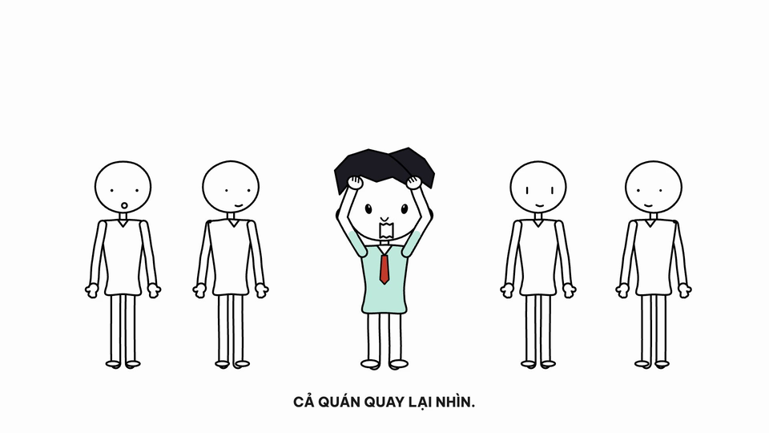
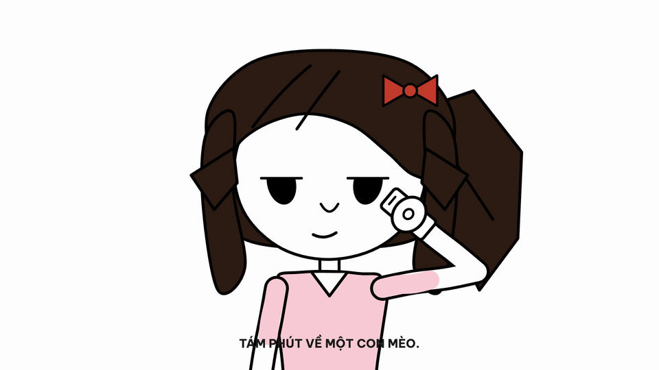
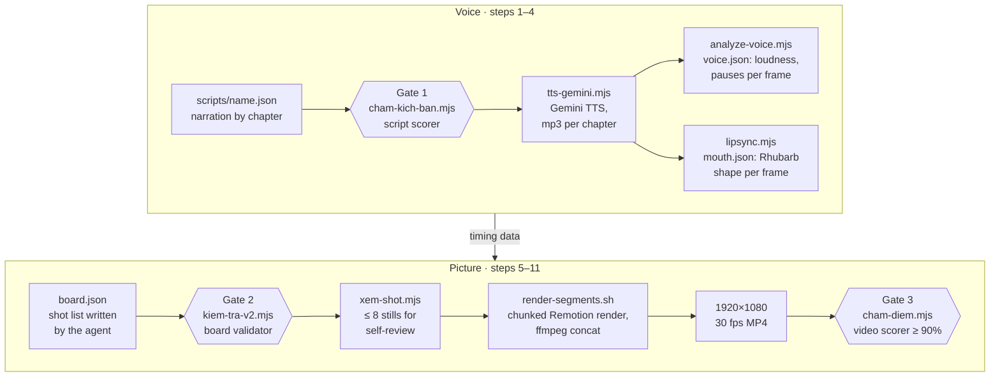

# video-studio

**Animated storytime videos, built entirely in code: script → voice → lip-sync → JSON shot list → 1080p MP4. Designed so an AI agent can direct a whole video by itself.**

*Dựng video hoạt hình kể chuyện bằng code: không phần mềm dựng phim, không timeline, agent tự làm được.*

**English** · [Tiếng Việt](README.vi.md)

<p align="center">
  
</p>

<p align="center"><sub>11.5 s excerpt from <code>first-date</code> ("First date: twelve topics and a cat", 1:41, Vietnamese voice-over, muted here). Every frame is rendered from JSON and React/SVG; no frame was drawn or edited by hand.</sub></p>

|  |  |  |
|:--:|:--:|:--:|
| Pre-built set `quan-cafe`, two actors, three-quarter view | Crowd shot: blank-faced extras snap from back view to front | Close-up: bored eyes, phone in hand |

## Why

- **No editor, no timeline.** A video is a narration script plus `board.json`, a shot list. Both are plain JSON, so every video can be diffed, reviewed and reverted in git.
- **An agent can direct it.** The agent decides which line of narration gets which shot, framing and acting beat. Code handles drawing, timing, lip-sync, rendering and grading.
- **Pacing comes from measurements.** Targets were measured frame by frame on reference storytime videos: 231 shots in 403 s, median shot 1.42 s, 31% of shots under 1 s, 100% hard cuts, about 16% of the time talking to camera. Three gates enforce those numbers, so a video that looks like a slideshow fails the gates. See [docs/nghien-cuu-storytime.md](docs/nghien-cuu-storytime.md).

## How it works



Every shot anchors to a phrase (`say`) that must appear word for word in the narration. Its start frame comes from the voice data: the phrase's character position is mapped onto the frames where the voice is actually speaking. Cuts land on words without anyone timing them by hand. Pose, eye and mouth changes snap on a single frame and then hold, which is how the genre animates. Whenever a character is speaking, the Rhubarb mouth track overrides the mouth shape.

## Agent-first

| Piece | What it does |
|---|---|
| [`.claude/skills/tao-video/SKILL.md`](.claude/skills/tao-video/SKILL.md) | The agent's manual. It comes with four references: script writing, a humor handbook (14 comedic mechanisms measured on real transcripts), shot grammar with numbers, and fixes for common validator errors. |
| `node pipeline/tao-video.mjs <name>` | One entry point that runs 11 idempotent steps. Steps that are already done are skipped. At step 5 it exits with code 3 and prints instructions until the agent writes `board.json`. Resume with `--tu kiem`. Exit codes: 0 means delivered with a score of at least 90%, 1 means rendered below 90%, 3 means waiting for the board. |
| `thu-vien-v2.json` | Every valid name (pose, eye, mouth, prop, set, action, sfx, music). It is generated from the source code, so the agent cannot invent a name that doesn't render. |
| Draw-as-data | When the library lacks something, the agent declares it in the board instead of editing TypeScript. `prop_tu_ve` takes custom props built from a small shape DSL (path, box, circle, line, text, accent fill). `boi_canh_tu_ve` takes sets composed from props, `do_cam_tu_ve` takes held items and `nhan_vat_tu_ve` takes characters. `xem-prop.mjs`, `xem-nhan-vat.mjs` and `xem-shot.mjs` render previews that the agent inspects. |
| Guard rails from real failures | The pipeline refuses to re-render a video that already exists (override with `--lam-lai`). The script gate blocks any script with more than 45% 3-gram overlap with an existing script, so an agent can't hand back an old video as new work. |

**End-to-end test.** For the second V2 video (`phong-van`), an agent followed the skill and wrote the 103-shot board itself, including two props it drew as data. That render scored **93% (13/14)** on the video scorer. The test exposed 13 gaps, which were then fixed in the skill and tools (commit `b615cf1`).

### The `board.json` contract

These are real shots from `src/projects/first-date/board.json` (chapter `den-som`, shots 4, 6 and 8). They produced the GIF above:

```json
{"say": "tôi đứng bật dậy nhanh quá", "loai": "phan-ung", "co": "trung", "sfx": "boing",
 "dien": [{"kieu": "nam", "x": 0.5, "mau": "giat-minh", "mau_tham_so": {"lui": 0.03}}]},
{"say": "đổ luôn cái ghế", "loai": "chu", "sfx": "thud",
 "chu": [{"noi_dung": "RẦM.", "kieu": "the", "vao": "phong", "mau": "#c0392b"}]},
{"say": "Em ấy bảo: anh ổn không", "loai": "chu", "sfx": "pop",
 "dien": [{"kieu": "ha", "x": 0.24, "mat": "soc", "mieng": "o",
           "act": [{"tai": 0, "mat": "soc", "mieng": "o"}, {"tai": 0.55, "mat": "nho", "mieng": "o"}]}],
 "chu": [{"noi_dung": "Anh ổn không?", "kieu": "the", "vi_tri": "phai"}]}
```

Field names are Vietnamese:

| Field | Meaning |
|---|---|
| `say` | Anchor phrase, quoted word for word from the narration |
| `loai` | Shot type (9): talking to camera, illustration, reaction, insert, text card, crowd, white beat… |
| `co` | Framing (5): wide → extreme close-up |
| `dien` | Actors: `kieu` character, `x` position, `dang` pose, `mat` eyes, `mieng` mouth, `goc` view angle, `cam` held item |
| `act` | Timed changes inside a shot (`tai` = seconds into the shot), each one a hard snap |
| `mau` | Action template (startle, run in, fall, shake head, …) |
| `chu`, `sfx`, `prop`, `boi_canh` | On-screen text, sound effect, props, pre-built set |

The full schema lives in [`src/v2/board/kieu-board.ts`](src/v2/board/kieu-board.ts), which is the single source of truth. Writing guide: [`src/v2/board/README.md`](src/v2/board/README.md).

## Quality gates

| Gate | Runs | Blocks on (examples) |
|---|---|---|
| **Script scorer**<br/>`cham-kich-ban.mjs` | Before TTS spends any quota | Chapters outside the word budget, runaway sentences, digits (the TTS misreads them), banned clichés. A missing cold open or closing call to the audience. A self-scored 10-criterion script rubric under 7. A chapter that shares nothing with the one before it. A near-copy of an existing script. It also warns on missing short punchlines, dialogue, concrete details and callbacks, and on English words the TTS mispronounces. |
| **Board validator**<br/>`kiem-tra-v2.mjs` | Before render | A `say` that isn't in the narration, unknown names, shots under 0.25 s. A talking-to-camera shot without exactly one speaker. Text cards on more than 15% of shots, fewer than 35% of shots with two characters, too few camera push-ins, no in-frame inserts. |
| **Pacing report**<br/>`thong-ke-board.mjs` | Before render (warn only) | Seconds per shot, % of shots under 1 s, % talking to camera, text per 15 s and white-beat %, compared with the reference |
| **Video scorer**<br/>`cham-diem.mjs` | After render | It measures the MP4 itself. Cut detection on downsampled 12 fps frames gives median shot length, % of shots under 1 s, % of held frames and % of white frames. The board adds variety counts (poses, angles, action templates, props, held items, act changes per minute), and the scorer also counts mouth-shape changes. The score is 0 if the duration drifts from the audio. **Below 90%, the video goes to `media/nhap/` (drafts) and isn't delivered.** |

Each delivered video gets a `media/outbound/<name>.md` with the scorer's table. The MP4s themselves are git-ignored.

## What's in the library

| | |
|---|---|
| Characters | 9 humans + 6 animals. The animals mount ears, snout, horns and tail on the same skeleton. |
| View angles | 4: front, three-quarter, profile, back |
| Poses | 43 |
| Eyes / mouths | 11 eye states. 21 mouth shapes: 9 Rhubarb visemes and 12 expressions. |
| Held items | 10 |
| Props / pre-built sets | 103 / 28 |
| Action templates | 21 |
| Sound effects | 29, synthesized from oscillators in Node (no samples) |

Line style: black lines on a near-white background. Each character gets one hair color, at most one accessory, flat pastel clothes and red accents. Line weight is uniform (`max(4.5 px, 0.015 × skull width)`). Bodies get a hand-drawn wobble that is seeded per body part, so it stays stable from frame to frame with no line boil. The characters are original designs. Only the measured film grammar of the genre (cut rhythm, holds, line weight) comes from the reference, JaidenAnimations-style storytime videos.

## Quick start

Requirements: Node.js 18+, macOS or Linux. ffmpeg ships with Remotion. Chrome/Chromium is detected automatically or downloaded by Remotion.

```bash
git clone https://github.com/ThinhHoang1/video-studio.git && cd video-studio
npm ci
cp .env.example .env                # set GEMINI_API_KEYS=key1,key2
node pipeline/tai-nhac.mjs --sfx    # CC BY music (not in git) + regenerate SFX
node pipeline/tai-rhubarb.mjs       # Rhubarb Lip Sync for this OS/arch (not in git)
npx remotion browser ensure         # only if no Chrome/Chromium is installed
```

These two commands try the gates without keys and without `npm ci`, on a fresh clone:

```bash
node pipeline/cham-kich-ban.mjs first-date   # script gate on an example script, ends with "✓ được TTS" (OK to synthesize)
node pipeline/thong-ke-board.mjs demo-v2     # pacing report for an example board vs. the reference
```

To make a new video:

```bash
# 1. write scripts/my-story.json            (format: SKILL.md, step 1)
node pipeline/tao-video.mjs my-story --soat          # gate → TTS → voice analysis → lip-sync → stops, exit 3
# 2. write src/projects/my-story/board.json  (format: SKILL.md, step 5)
node pipeline/tao-video.mjs my-story --tu kiem --soat  # validate → register → stills → render → score
# → media/outbound/my-story.mp4 + media/outbound/my-story.md
```

`npm run dev` opens Remotion Studio for interactive preview.

## Repo layout

| Path | Contents |
|---|---|
| `.claude/skills/tao-video/` | Agent skill and references. A second skill, `tao-ban-tin/`, covers a daily news-bulletin format. |
| `pipeline/` | Node scripts: TTS, voice analysis, lip-sync, gates, registration, previews, scorer, asset downloaders |
| `src/v2/rig/` | Character rig: skeleton, poses, eyes, mouths, hair, hands, held items, animal parts |
| `src/v2/props/`, `src/v2/boi-canh.ts` | Props and pre-built sets |
| `src/v2/act/` | Action templates and in-shot timing |
| `src/v2/board/` | Board schema (`kieu-board.ts`) and writing guide |
| `src/v2/phim/` | Renderer: anchors `say` → frame, stage, composition |
| `src/projects/<name>/` | Per-video `board.json` plus generated `voice.json` / `mouth.json` / durations |
| `scripts/` | Narration scripts |
| `thu-vien-v2.json` | Catalogue of valid names, generated by `pipeline/thu-vien-v2.mjs` |
| `docs/` | Research measurements and design docs (Vietnamese) |
| `media/outbound/` | Delivered videos (MP4 git-ignored) and their metadata/scorer reports |
| `src/engine/`, `src/library/`, `src/attic/` | V1 engine and experiments, kept for re-rendering two older videos |

Identifiers are Vietnamese: `tao-video` = make video, `cham-kich-ban` = grade script, `kiem-tra` = check, `thong-ke` = stats, `dang-ky` = register, `xem` = preview, `cham-diem` = score, `thu-vien` = library.

## Tech stack

- **Remotion 4** + **React 19** + **TypeScript**. The rig, props and text are React components that draw SVG at exact pixel coordinates, so line weight stays exact at every size.
- **Node.js (ESM)** for the whole pipeline. No Python is required.
- **Gemini TTS**: style-prompted voices, with rotation across key × model pairs to stretch free-tier quota.
- **Rhubarb Lip Sync 1.14** with the `phonetic` recognizer, which is language-independent and handles Vietnamese.
- **ffmpeg** (bundled with Remotion's compositor) for audio conversion, frame sampling and segment concat.
- **Agent skill** in the `.claude/skills/` format (Claude Code / Agent Skills).

## Known limits

| | |
|---|---|
| Lip-sync | Rhubarb matches sentence rhythm 100% but only about 60% of individual sounds. That is fine in medium and close shots and visible in long extreme close-ups. |
| TTS quota | The free tier allows 10 requests/day per key × model. 2 keys × 3 models ≈ 60 chapters/day. |
| Render speed | About 15–17 frames/s on an Apple M4. A 90 s video takes about 2.5 min. |
| Taste | The scorer measures pacing and variety, not beauty or humor. The skill makes the agent inspect stills, and a human should watch before publishing. |
| Language | The narration, the script-gate heuristics, the docs and the identifiers are all Vietnamese. |

## Credits and licensing

- **Remotion** is free for individuals and small teams. Larger companies need a company license; see [remotion.dev/license](https://www.remotion.dev/license).
- **Rhubarb Lip Sync** (MIT) is downloaded by `pipeline/tai-rhubarb.mjs` and isn't redistributed here.
- **Music**: CC BY tracks by Kevin MacLeod (incompetech.com), downloaded by `pipeline/tai-nhac.mjs`. **Attribution is required when publishing.** See `public/audio/CREDITS.md`, which the downloader writes.
- **Sound effects** in `public/sfx/` are synthesized by `pipeline/sfx.mjs` and contain no third-party audio.
- **Fonts**: Be Vietnam Pro and Patrick Hand (Google Fonts, SIL OFL), loaded via `@remotion/google-fonts`.
- Third-party meme images are git-ignored and not redistributed.
- The repository doesn't include a `LICENSE` file yet, so default copyright applies to the code.

## Further reading (Vietnamese)

| File | Read it for |
|---|---|
| [`docs/nghien-cuu-storytime.md`](docs/nghien-cuu-storytime.md) | Measurements of the reference genre: timing, line weight, lip-sync, shot grammar |
| [`docs/thiet-ke-v2.md`](docs/thiet-ke-v2.md) | Design of the rig, board and renderer, and why each decision was made |
| [`ARCHITECTURE.md`](ARCHITECTURE.md) | How a shot travels from `say` to pixels; lip-sync internals |
| [`docs/vi-sao-video-bi-dung.md`](docs/vi-sao-video-bi-dung.md) | Why a video looks frozen or like a slideshow, and the fixes |
| [`docs/thu-vien-canh.md`](docs/thu-vien-canh.md) | Library catalogue: sets, props, poses, actions, sfx, music |
